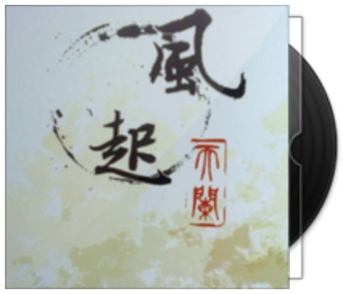

# 风起天阑





发行时间: 2010-09-30
[(ref)](https://baike.baidu.com/item/%E9%A3%8E%E8%B5%B7%E5%A4%A9%E9%98%91/2065?fromModule=lemma_inlink)

5sing [https://5sing.kugou.com/462455/zj/515149f7e2dafe11f47d6105.html](https://5sing.kugou.com/462455/zj/515149f7e2dafe11f47d6105.html)  
网易云 [https://music.163.com/#/album?id=9896](https://music.163.com/#/album?id=9896)

## 风起天阑

5sing [https://5sing.kugou.com/yc/1705473.html](https://5sing.kugou.com/yc/1705473.html)  
网易云 [https://music.163.com/#/song?id=101106](https://music.163.com/#/song?id=101106)  
其他 [https://hetu-music.com/zh-CN/song/303](https://hetu-music.com/zh-CN/song/303)

<!-- <summmary>灵感</summmary> https://home.gamer.com.tw/artwork.php?sn=2886671 -->
<details><small>
<div class="auto-wrap" width="100%" font size="1">

这个词原本只是准备写一个守城女将和默默暗恋她的守夜人的故事。是的，守城的是女人，词里的第一人称“我”是男人。但写了开头两三段后我忽然觉得，以倾尽为背景写的话，貌似很带感。跟河图讨论了下，他也觉得不错，于是开始改设定。我写文案的时候，跟河图在文案的叙述视角上产生了很大的意见分歧，彼此不能说服对方。最初的文案只有一句话：崇宁七年七月，白炎军破平陵城，斩守将谢婉。为啥是平陵后面再说。我认为谢婉只对于天阑城有意义，而对于白炎来说她只是个也许连名字都不知道的敌将，后面如果再加上白炎破王城等等的情节，叙述角度就非常怪异，因为这两桩事并不是同等重量的。河图坚持都要提及，于是才有了各自写一个白话版的设定这事，他写的就是发围脖的那个。之后依然意见相左，于是又¥@&！地争论了很久…最后我终于想到了两全的解决办法，那就是将文案写成城志。<br>
题目原本叫《破城》，双关，切合歌本身。但由于这故事并非孤立存在，而是架空大背景下众多故事中的一个，所以从整体上考虑，用了《风起天阑》，取风起于青苹之末的意思。火光照亮夜空的时候，并没有人想到，天阑城破会是王朝易主的序幕，许多人的命运会从那夜开始，不可逆转地被改变。<br><br>  

花絮先到这儿，有空再说。一屋人前仆后继地倒下了。我也要倒了orz 最后回答几个简单的问题。谢婉是女人。谢婉不是朱砂也不是白炎。朱砂和白炎都不认识谢婉。词里的“我”不是任何一个已知的人，这段虚构的历史里，没有他的名字。其实我说的这些，已经有不少人推导出来。故事固然有暗线在，但明线并不是那么难懂，只是需要抛开“这是倾尽续集”的想法。另外我很期待有人能解读出暗线啊。<br><br>  

河图的歌，很大一个特点在于——有故事，就像倾尽，因为是故事，所以更打动人，更能让我们无法忘怀。<br>
一首歌就是一个故事，一个灵魂，用心感悟才能得出故事里的真谛。<br> 就好像河图所说，它们最终会被每一个想听的人听到，这是每个音乐人的希望，也是每一首音乐被赋予的希望。
</div></small>
</details><br>

故事/人设/文案/作词：Finale  
作曲/编曲/演唱：河图  

……崇宁七年七月，白炎军攻城，是为乱始。守将谢婉率众苦战，不得援。七月廿六，城破，婉力竭被擒，不肯降，为炎军枭首。八年春，炎夺帝都天岁，鸩敬帝，清朝堂，废宫室。二月即位，定国号周，改元永初。即周元帝。  
永初十年冬，元帝崩，朝野翻覆，诸王皆谋自立。时有乱军夜袭，见婉披发执枪于城上，肝胆俱裂，乃退。十一年，新帝彻平乱登基，改元太业。  
太业后，城中始有谣歌传唱。歌曰：安危何所系，天阑谢将军。太业三年，城东设谢婉衣冠祠，香火终年不绝。  
——《天阑城志·谢婉传》

```markdown
火光凄厉地照亮夜 城破时天边正残月
那一眼你笑如昙花 转眼凋谢
血色的风把旗撕裂 城头的灯终于熄灭
看不到你头颅高悬 眼神轻蔑

焚成灰的蝴蝶 断了根的枝叶
挣脱眼眶前冻结的悲切
鲜血流过长街 耳畔杀伐不歇
守护的城阙大雨中呜咽

多年后史书页 还把这夜撰写
青石长阶 染尽生离死别
耳闻的像终结 眼见的都毁灭
温柔的最决绝 坠落的曾摇曳

恍然间已诀别 正褪色的长夜
破晓之前 洗去所有罪孽
有人喊你名字 直到声嘶力竭
若魂魄能知觉 黄泉下不忘却

不记得阴晴或圆缺 我看过花开和花谢
渐渐地回忆起喜悦 与恨有别
王城的姓氏都改写 我还在这里守着夜
等什么从灰烬里面 破茧成蝶

是命运在轮回 熟悉得像幻觉
火烧破天空星辰都倾泻
马蹄踏碎落叶 四方边角不绝
血滚落尘土像那瞬艳烈

太遥远的岁月 看不清的眉睫
回忆尽头 风声依旧凛冽
埋下的骨和血 早沉没在黑夜
逝去的已冰冷 飘零的未了结

记得城中日月 蝉鸣后又初雪
屋檐细雨 停在初见季节
用最平淡话语 藏住旧日誓约
春风绿过柳叶 你曾笑得无邪

逆风穿越荒野 来不及去告别
破晓之前 忘记所有胆怯
从此用我双眼 替你看这世界
云万里山千叠 天尽头城不夜

依稀是旧时节 城门上下弦月
白色身影 夜色如水清冽
借我一刻光阴 把你看得真切
身后花开成雪 月光里不凋谢
```


## 不见长安

5sing [https://5sing.kugou.com/yc/1705474.html](https://5sing.kugou.com/yc/1705474.html)  
网易云 [https://music.163.com/#/song?id=101109](https://music.163.com/#/song?id=101109)  
其他 [https://hetu-music.com/zh-CN/song/297](https://hetu-music.com/zh-CN/song/297)

作词：Finale  
作曲：河图  

我一个人走过千万里，从没觉得孤独。开始觉得孤独，那是到长安之后的事了。  
每个人的心里都有一座长安城。我花了一辈子，才弄清楚自己其实从没到过那里。  

```markdown
村头古树下青草叶上 露水未凝干
晨雾里渡船唱着歌谣 撑过小河湾
我枕着手臂躺在屋顶 想了一整晚
瓦下厅堂中谁又说起 纸上的长安

桥面像结霜鞋底冰凉 踏过青石板
擦肩的姑娘眉眼弯弯 笑得多恬淡
我背着行囊坐上渡船 扶舷回头看
村落轮廓里炊烟渐次 升起又飘散

我忽然开始疯狂想念 故事里的长安
我日夜兼程跋山涉水 山水路漫漫
这一路走来千里万里 看花开过几转
春夏秋冬风依次抚过 我发端

我路过小镇夜凉如水 天边月正弯
路过了江南看到书生 睡在杨柳岸
我路过长街熙熙攘攘 叫卖都宛转
路过了洛阳看到小姐 画楼绣牡丹

我渐渐开始每晚梦到 故事里的长安
长安城有人歌诗三百 歌尽了悲欢
抵达的时候阳光正好 听风吹得暖软
可我为什么忽然失措 在长安

这重重楼阁浩浩殿堂 都不是我想象
我心中曾有画卷一幅 画着它模样
长安城忽然开始下雨 湿了繁华沧桑
慌张人潮里我遗忘了 来时的方向

那年转身离去
水声远了河岸
村落是否依然
千万里外我怅然回看
```


## 第三十八年夏至

5sing [https://5sing.kugou.com/yc/1705478.html](https://5sing.kugou.com/yc/1705478.html)  
网易云 [https://music.163.com/#/song?id=101112](https://music.163.com/#/song?id=101112)  
其他 [https://hetu-music.com/zh-CN/song/302](https://hetu-music.com/zh-CN/song/302)

第叁拾捌年夏至  
作词：狐离  
作曲：河图  

我记得第38年夏至,你说过会带我去台北

```markdown
衰草连横向晚晴 半城柳色半声笛
枉将绿蜡作红玉 满座衣冠无相忆
时光 来复去

斜屏半倚 拉长了光影
重彩朱漆 斑驳了画意
一出纸醉金迷闹剧
一袭染尽红尘的衣
唱罢西厢谁盼得此生相许


灯下的影 粉饰着回忆
老旧唱机 轮回了思绪
一封泛黄褶皱的信
一支勾勒眉角的笔
花腔宛转着应和陈年的曲

衣香鬓影掩过了几声叹息
冷眼看过了霓虹几场别离


他还演着那场郎骑竹马来的戏
他还穿着那件花影重迭的衣
他还陷在那段隔世经年的梦
静静合衣睡去 不理朝夕

他演尽了悲欢也无人相和的戏
那烛火未明摇曳满地的冷清
他摇落了繁花空等谁来记起
为梦送行的人 仍未散去

还有谁陪我痴迷看这场旧戏
还有谁为我而停谁伴我如衣
```


## 命悬一线

网易云 [https://music.163.com/#/song?id=101116](https://music.163.com/#/song?id=101116)  
其他 [https://hetu-music.com/zh-CN/song/299](https://hetu-music.com/zh-CN/song/299)

作词：Finale  
作曲：河图  

```markdown
广场上有多少人在表演
努力试验去投入热恋
有人反复说着誓言
用力相信信念
离去时却仓促像一阵烟

世界从来没有所谓永远
一切愈美也就愈会变
快门企图凝固时间
不知举止肤浅
谁能够把幸福存进相片

一刻高山一刻深渊
陌路同途并肩沦陷
从开始之后到结束之前
什么操控种种收拢成掌中的线
让所有表情都影射终点

有人曾沿着世界绕几圈
最完美飞机舷窗中的侧脸
在云端回忆过一生画面
到最后哭泣在坠毁的一瞬间

有人曾站在金字塔的高点
最廉价数不清妒忌与羡艳
走过了这段万人簇拥路
逃不过墓碑下那孤独的长眠

广场上有多少人在表演
努力试验去证明永远
有人追过岁岁年年
谨记约定时限
转身后却忘了如何思念

一刻海水一刻火焰
陌路同途并肩沦陷
从开始之后到结束之前
什么操控种种收拢成掌中的线
让所有表情都映射终点

一句话从生涩说到熟练
台风雨造访了风球第几遍
总有人情愿去吞下谎言
看不到甘甜后要背负的锁链

一首歌从深情唱到敷衍
坏掉的卡带它倒不回从前
总有人相濡以沫二十年
却输给天真或妖冶的一张脸

高架桥依然喧嚣着蔓延
摩天楼分割天空视线
人群中匆匆陌生眉眼
依然各怀心愿
在一无所知时彼此擦肩
```


## 白衣

5sing [https://5sing.kugou.com/yc/1705482.html](https://5sing.kugou.com/yc/1705482.html)  
网易云 [https://music.163.com/#/song?id=101118](https://music.163.com/#/song?id=101118)  
其他 [https://hetu-music.com/zh-CN/song/301](https://hetu-music.com/zh-CN/song/301)

作词：Darsity  
作曲：河图  

```markdown
谁曾在城门深雨中，寻觅过我
雕得古拙的山水，夜把明月照
我留下传唱的歌谣多少
奉旨而挥的笔墨，每为绮罗消
谁懂我的潦倒谁又知我的骄傲

谁曾在烟花巷陌里，等待过我
开了又败的花墙，只剩下斑驳
我曾与过谁在花下欢笑
青瓷如水的女子，宁静中微笑
岁月静凋时才知道已不复年少

风吹开枯叶抖落了空蝉
掉在开满牡丹的庭院
台上唱歌还要挂着珠帘
怎么可能让我的笔惊艳

这白衣 是平凡 也习惯
新词一夜唱了八九遍；
换了断弦琵琶再复返；
对酒当歌长亭晚；
品其中味 一成不变。

这白衣 是羁绊 是疲倦
杯空杯满谁将酒打翻
抛了乱卷换我醉中仙
就算看不清眼前

谁风雨不改红楼游，载不动悲愁
满座诗赋换热酒，此局棋怎走
尘香露花莹流连珠帘后
黄土尘尘何辽阔，难再听前奏
淡看秋雨凄凄功名佳人伴今宵

风吹开枯叶抖落了空蝉
掉在开满牡丹的庭院
台上唱歌还要挂着珠帘
怎么可能让我的笔惊艳

这白衣 是平凡 也习惯
新词一夜唱了八九遍
换了断弦琵琶再复返
对酒当歌长亭晚
品其中味 一成不变

这白衣 是永远 也瞬间
今夜的灯油已经烧干；
故事我还没写完一半；
过去谁帮我杜撰；

一步踏尽一树白
一桥轻雨一伞开
一梦黄粱一壶酒
一身白衣一生裁

这白衣 是平凡 也习惯
新词一夜唱了八九遍
换了断弦琵琶再复返
对酒当歌长亭晚
品其中味 一成不变

这白衣 是永远 也瞬间
今夜的灯油已经烧干
故事我还没写完一半
过去谁帮我杜撰
```


## 伶仃谣

5sing [https://5sing.kugou.com/yc/1705484.html](https://5sing.kugou.com/yc/1705484.html)  
网易云 [https://music.163.com/#/song?id=101120](https://music.163.com/#/song?id=101120)  
其他 [https://hetu-music.com/zh-CN/song/298](https://hetu-music.com/zh-CN/song/298)

作词：狐离  
作曲：河图  

生日礼物给你们

```markdown
杳杳飞花 散落天涯 让那些白骨 别忘了回家
清明灞上 牧笛悠扬 催行人断肠 又泪如雨下

浅浅池塘 锦鲤成双 风缠绵着刮 听一夜落花
生死茫茫 雪衣如华 伶仃的白发 梳弄着牵挂


谁在哭 啊哭伤了城墙 谁在笑啊触目的荒凉
谁的眼啊嘲笑这浮华 谁安静地不用再说话

流云流走我指间的沙 风吹旧了黑白色遗画
你种的柳新长了枝桠 莺飞草长又是一年春夏


流萤四散 殇歌安详 远行的灵魂 已不再回望
杏花村庄 炊烟初上 哪一程琴声 弥散了天光

谁在哭啊哭暗了天狼 谁在笑啊透骨的丹砂
谁的青衫被暮色埋葬 谁的梦还有蝶翅轻展

暖黄烛光谁剪了一晚 门前石阶泪多了几行
谁推开了那雕花的窗 怕你漏看引路的沉香

槐火纷乱 寒烟微凉 你在彼方 莫失莫忘
桥边的童谣 会不会唱 唱你留下的 那些过往

雨落隔岸 河过忘川 沉默的船家 你渡谁过江
曲水弯弯 陌上谁家 点灯的姑娘 他回来了吗
```


## 安徒生的事

网易云 [https://music.163.com/#/song?id=101121](https://music.163.com/#/song?id=101121)  
其他 [https://hetu-music.com/zh-CN/song/300](https://hetu-music.com/zh-CN/song/300)

和图图合作的第一首歌，很满意，如果有人是按曲读懂一个词，那就有人能把词解读透，我想这个人就是河图了，呵呵！希望听歌的人在这场安徒生中，找到自己的童话

作词：EDIQ  
作曲：河图  
```markdown
商人们在码头边谈论
今天一袋红宝石成交价格
我从鹅卵石阶梯走下
想童话也能点缀平静生活

小鞋匠在酒馆外张望什么
朗姆酒该是被谁偷喝了
我习惯清嗓后开始在剧院唱歌
只是连歌声都只沦为配角

我安静离开那种生活
拿起羽毛笔又想写点什么
精灵路过我房间角落
说罗斯基里达夜晚归航了

我检票经历风暴和岛屿 (Let our mind start to explore)
大海的人鱼在陪伴着我
打火匣在暗涌中被老船长点燃 (Pass around the world)
照亮了灵魂深处的漩涡

我想我需要在这场童话中 找哪只天鹅 (Fairy tale is my song)
读不懂的人都在蹉跎过着 忙碌的生活
听哪些提线木偶在字里行间 交谈着什么 (In the place you gonna go)
它们怎懂得那些 人心的悱恻

她寂寞守候一个城堡 (Let our mind start to explore)
骑不骑士的传说不想知道
于是我在游记中记载 (Pass around the world)
记载十九世纪留下的记号

我愿意买下她手中的火柴 (Let our mind start to explore)
等晚年时候悄悄的划亮
光芒中锡兵答应陪我沿途寻找 (Pass around the world)
寻找孩子丢失街边的微笑
Let your soul take you away
Loneliness can turn to love
听哪些提线木偶在字里行间 交谈着什么 (It can bring you the feeling of happiness)
它们怎懂得那些 人心的悱恻 (This is my magic)

我想我需要在这场童话中 客串个角色 (Let your soul take you away)
看不出的人都在灯塔下面 竭斯底里的 (Loneliness can turn to love)
笔下的这本新书明天会流浪到 哪家出版社 (It can bring you the feeling of happiness)
合眼丹麦的冬天 就快要过去了 (This is my magic)

掌声后 我想我们也各有所得
-The End-
```

