# 倾尽天下


发行时间: 2013-01-19
[(ref)](https://baike.baidu.com/item/%E5%80%BE%E5%B0%BD%E5%A4%A9%E4%B8%8B/8081503?fromModule=lemma_inlink)

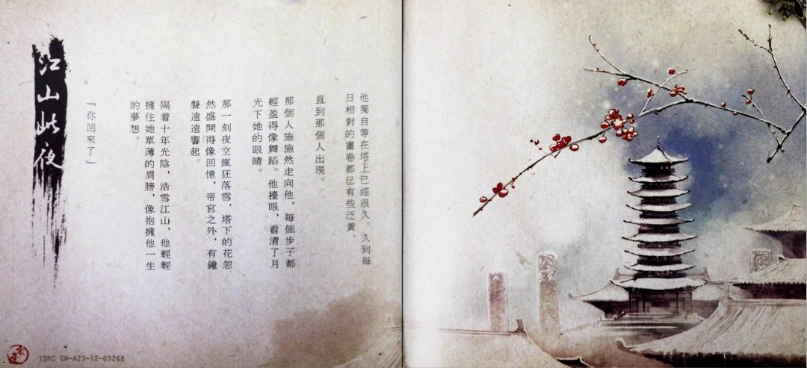
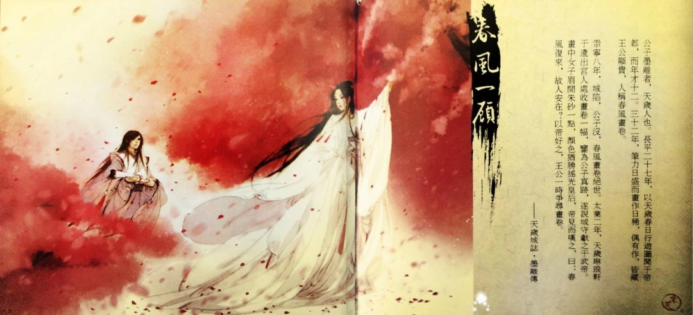
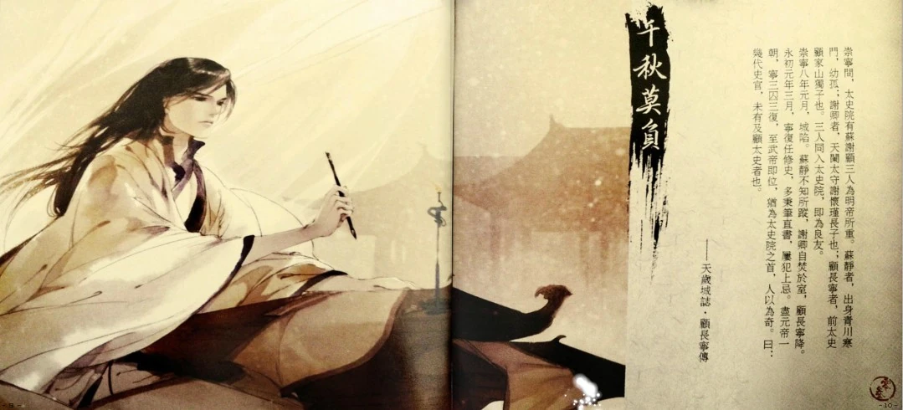
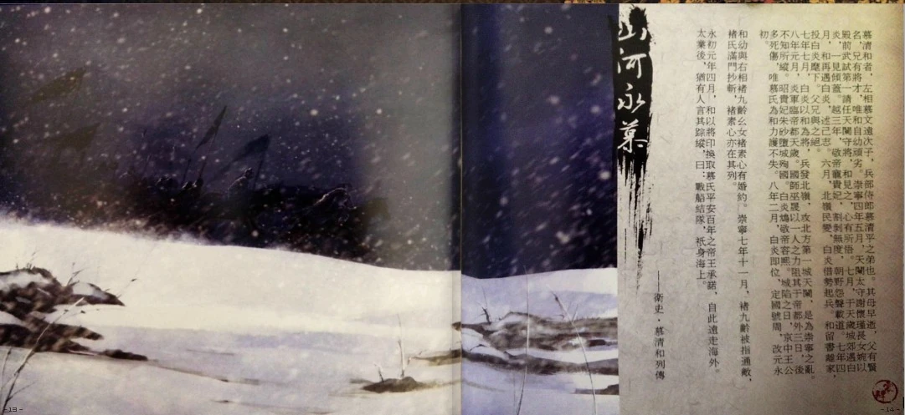
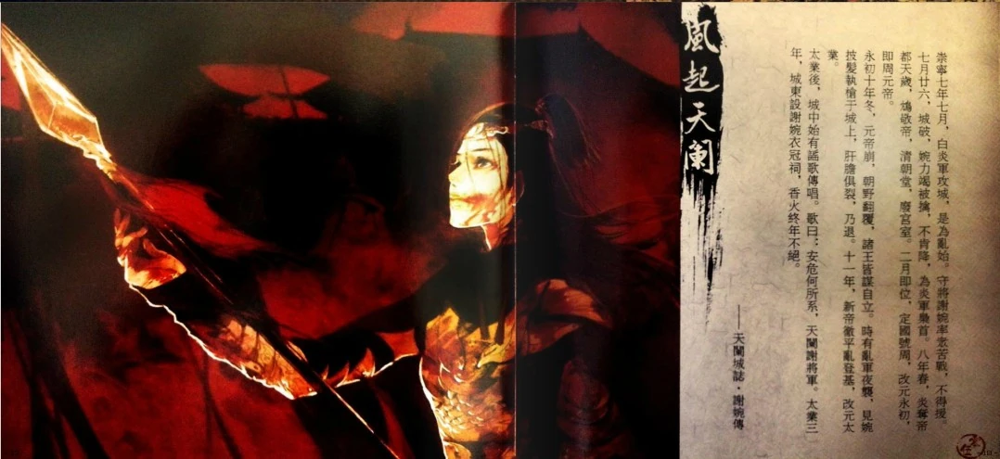
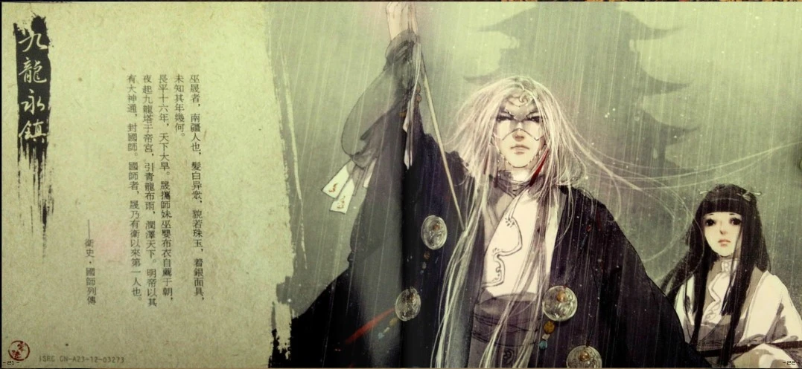
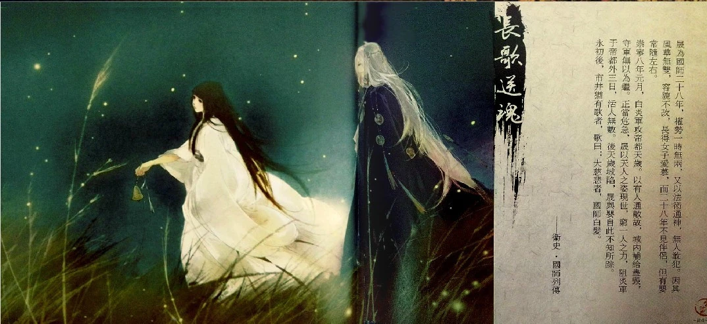
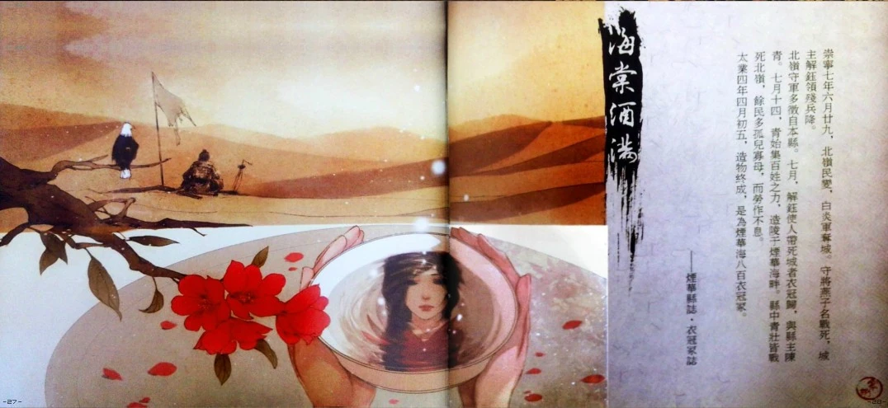
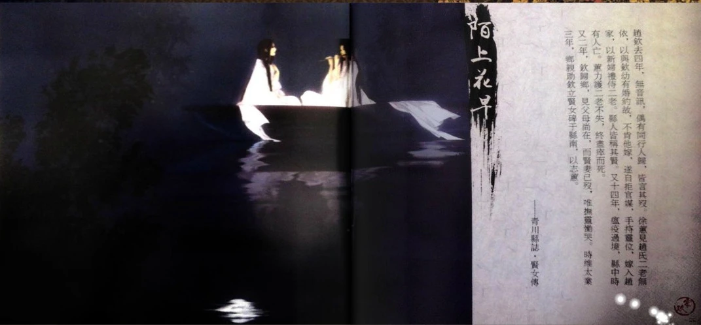
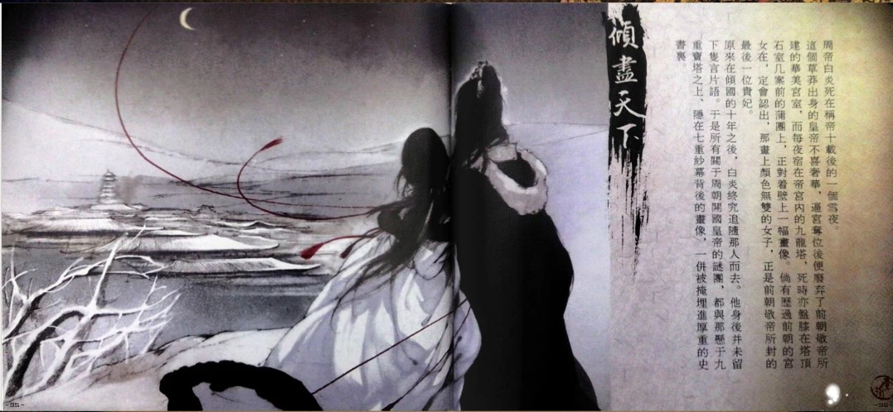
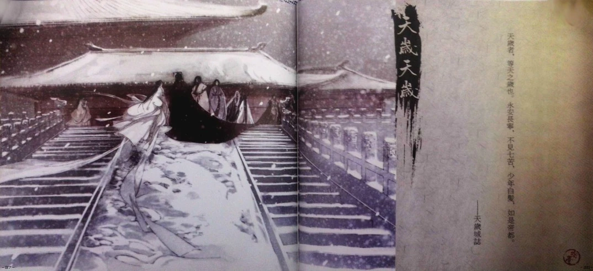


5sing [https://5sing.kugou.com/462455/zj/515fefe8e2dafe1818c21984.html](https://5sing.kugou.com/462455/zj/515fefe8e2dafe1818c21984.html)  
网易云 [https://music.163.com/#/album?id=2639425](https://music.163.com/#/album?id=2639425)  

<!--
<details><small>
<div class="auto-wrap" width="100%">
</div></small>
</details><br>

```markdown
```
-->


## 江山此夜

5sing [https://5sing.kugou.com/yc/1824192.html](https://5sing.kugou.com/yc/1824192.html)  
网易云 [https://music.163.com/#/song?id=27571858](https://music.163.com/#/song?id=27571858)  
其他 [https://hetu-music.com/zh-CN/song/14](https://hetu-music.com/zh-CN/song/14)  


**江山此夜**

故事/人设/文案：Finale  
作曲/编曲：河图  

他独自等在塔上已经很久。久到每日相对的画卷都已有些泛黄。  
直到那个人出现。  
那个人施施然走向他，每个步子都轻盈得像舞蹈。他抬眼，看清了月光下她的眼睛。  
那一刻夜空疯狂落雪，塔下的花忽然盛开得像回忆，帝宫之外，有钟声远远响起。  
隔着十年光阴，浩雪江山，他轻轻拥住她单薄的肩膀，像抱拥他一生的梦想。  
“你回来了。”  


## 春风一顾

5sing [https://5sing.kugou.com/yc/1824180.html](https://5sing.kugou.com/yc/1824180.html)  
网易云 [https://music.163.com/#/song?id=27571859](https://music.163.com/#/song?id=27571859)  
其他 [https://hetu-music.com/zh-CN/song/13](https://hetu-music.com/zh-CN/song/13)  


**春风一顾**

故事/人设/文案/作词：Finale  
作曲/编曲/演唱：河图  

公子墨离者，天岁人也。长平二十七年，以天岁春日行游图闻于帝都，而年才十二。三十二年，笔力日盛而画作日稀，偶有作，皆藏王公显贵，人称春风画卷。  
……崇宁八年，城陷，公子没，春风画卷绝世。太业二年，天岁琳琅轩于遣出宫人处收画卷一幅，鉴为公子真迹，遂说城守献之于武帝。画中女子眉间朱砂一点，颜色犹胜摇光皇后，帝见而叹之，曰：春风复来，故人安在？以帝好之，王公一时争寻画卷。  
——《天岁城志·墨离传》

```markdown
春风画卷三百里榴火
看痴风光怎么去着墨
你林间过 鸦鬓簪花一朵
回眸语脉脉

转头十年眼见王城破
朱砂一点终美到零落
鲜血去筹措
不过留下几句执着

千里奔赴一笑而过
不管不顾世人说
几杯青罗拂能醉我
上宫楼独卧

眼底辉光掌中烛火
九龙塔高影寂寞
一缕故人思不叫破
天地此夜雪婆娑

案上残红雨打风吹落
一坛愿酒又十年蹉跎
日月如梭 人海里任漂泊
小舟看烟波

夜深梦深念昔日因果
命签一支批下因缘错
提笔还斟酌
满壁画像一室沉默

你的名字谁的王座
稗官野史还猜度
前尘里旧事早淹没
风在青苹末

系发挽袖铺纸研墨
画得那年林间过
七重纱幕后你眼波
风流只向一人说

我也曾林间过
二十年 换一眼花开落
```


## 千秋莫负

5sing [https://5sing.kugou.com/yc/1824188.html](https://5sing.kugou.com/yc/1824188.html)  
网易云 [https://music.163.com/#/song?id=27571860](https://music.163.com/#/song?id=27571860)  
其他 [https://hetu-music.com/zh-CN/song/10](https://hetu-music.com/zh-CN/song/10)  


**千秋莫负**

故事/人设/文案/作词：Finale  
作曲/编曲/演唱：河图  

……崇宁间，太史院有苏谢顾三人为敬帝所重。苏静者，出身青川寒门，幼孤；谢卿者，天阑太守谢怀瑾长子也；顾长宁者，前太史顾家山独子也。三人同入太史院，即为良友。  
崇宁八年元月，城陷。苏静不知所踪，谢卿自焚于室，顾长宁降。  
永初元年三月，宁复任修史，多秉笔直书，屡犯上忌。尽元帝一朝，宁三囚三复，至武帝即位，犹为太史院之首，人以为奇。曰：几代史官，未有及顾太史者也。  
——《天岁城志·顾长宁传》

```markdown
日月无颜色 这一笔不诉史册
锦绣若成灰 会点染山河
千年尘封后 是否还记得
这画卷 曾以火与血勾勒
抛生与死守不住好辰光一刻
满目仓皇 四面悲歌

看高台成废墟 听凄鸣一瞬间
说陨落唱凯旋 拼真实的碎片
走过市井遗泉 捕风里只语片言
荒冢中无名白骨 是谁家青春笑颜
岁月依旧一双洞悉的眼 看炊烟远了硝烟
任凭世人发愿千万 不置一言

十里皆缟素 这一场不忌歌哭
冬雪与春风 谁把谁辜负
最恨留不住 故人已故
遗忘前 写下最终与最初
一字一句清晰那些模糊面目
他曾悲欢 她曾喜怒

看高台成废墟 听凄鸣一瞬间
说陨落唱凯旋 拼真实的碎片
走过市井遗泉 捕风里只语片言
荒冢中无名白骨 是谁家青春笑颜
岁月依旧一双洞悉的眼 看炊烟远了硝烟
任凭世人发愿千万 不置一言
```


## 山河永慕

5sing [https://5sing.kugou.com/yc/1744035.html](https://5sing.kugou.com/yc/1744035.html)  
网易云 [https://music.163.com/#/song?id=27571861](https://music.163.com/#/song?id=27571861)  
其他 [https://hetu-music.com/zh-CN/song/12](https://hetu-music.com/zh-CN/song/12)  


**山河永慕**

故事/人设/文案/作词：Finale  
作曲/编曲/演唱：河图  

慕清和者，左相慕文远次子，兵部侍郎慕清平之弟也。其母早逝，父有贤名，兄有将才，唯和自幼顽劣。崇宁四年五月，天阑太守谢怀瑾长女婉以殿前武试第一请任天阑守将，和见之，心有所悟。七月，于天岁城郊遇白炎，一见倾盖。越三年，敬帝宠贵妃，割剥无度，朝野怨声载道。七年四月，和再遇白炎，述己志。六月，北岭民变，白炎借势起兵。和留书离家，投白炎麾下。父兄与之绝。  
七年七月，白炎以和为将，兵发北岭，攻北方第一城天阑，是为崇宁之乱。八年元月，炎军临帝都天岁。国师巫晟以一人之力阻其于帝都外三日，后不知所踪。贵妃朱砂堕城殉国。白炎鸩敬帝容熙。城陷之日，京中王公多死伤，唯慕氏为和力护不失。八年二月，白炎即位，定国号周，改元永初。  
……和幼与右相褚九龄幺女褚素心有婚约。崇宁七年十一月，褚九龄被指通敌，褚氏满门抄斩，褚素心亦在其列。……  
永初元年四月，和以将印换取慕氏平安百年之帝王承诺，自此远走海外。太业后，犹有人言其踪迹，曰：战船结队，只身海上。  
——《卫史·慕清和列传》

```markdown
是涅槃那瞬的颜色 谁举旗比烈火炽热
抬眼间已换了山河
为你唱三百夜情歌 尘与土飞扬成过客
远望时有没有不舍

崇宁七年春 天正惊蛰
白虎随形黑鸦在侧 暗月之下逆旅者
北斗星知道 前路曲折
万人阵前一杯说奈何 还得乡有几个

苍龙负图山巍峨 九十九曲水清澈
问着荣耀背后 荆棘血路 值得不值得
乱世慷慨我行歌 千万人中有相和
所有人间烟火 悲欢离合 日月星辰会记得

是指间渐冷的誓约 谁紧握比生命殷切
不放开到星火熄灭
为你守十二夜圆缺 青烟里隔了阴阳界
剩那年初见时一瞥

长夜终将尽 黎明似铁
来也凛冽去也孤绝 动如参商不须别
永安钟清正 空响长街
昔日少年依旧思无邪 一回望一拜谢

苍龙负图山千叠 九十九曲水不歇
正是朝阳万里 燃点城阙 远大这时节
一片柳叶吹成雪 舟中温柔海上月
记得人间最好 一笑照夜 梦里失约歌里借
```


## 风起天阑

5sing [https://5sing.kugou.com/yc/1705473.html](https://5sing.kugou.com/yc/1705473.html)  
网易云 [https://music.163.com/#/song?id=27571862](https://music.163.com/#/song?id=27571862)  
其他 [https://hetu-music.com/zh-CN/song/18](https://hetu-music.com/zh-CN/song/18)  


**风起天阑**

故事/人设/文案/作词：Finale  
作曲/编曲/演唱：河图  

……崇宁七年七月，白炎军攻城，是为乱始。守将谢婉率众苦战，不得援。七月廿六，城破，婉力竭被擒，不肯降，为炎军枭首。八年春，炎夺帝都天岁，鸩敬帝，清朝堂，废宫室。二月即位，定国号周，改元永初。即周元帝。  
永初十年冬，元帝崩，朝野翻覆，诸王皆谋自立。时有乱军夜袭，见婉披发执枪于城上，肝胆俱裂，乃退。十一年，新帝彻平乱登基，改元太业。  
太业后，城中始有谣歌传唱。歌曰：安危何所系，天阑谢将军。太业三年，城东设谢婉衣冠祠，香火终年不绝。  
——《天阑城志·谢婉传》

```markdown
火光凄厉地照亮夜 城破时天边正残月
那一眼你笑如昙花 转眼凋谢
血色的风把旗撕裂 城头的灯终于熄灭
看不到你头颅高悬 眼神轻蔑

焚成灰的蝴蝶 断了根的枝叶
挣脱眼眶前冻结的悲切
鲜血流过长街 耳畔杀伐不歇
守护的城阙大雨中呜咽

多年后史书页 还把这夜撰写
青石长阶 染尽生离死别
耳闻的像终结 眼见的都毁灭
温柔的最决绝 坠落的曾摇曳

恍然间已诀别 正褪色的长夜
破晓之前 洗去所有罪孽
有人喊你名字 直到声嘶力竭
若魂魄能知觉 黄泉下不忘却

不记得阴晴或圆缺 我看过花开和花谢
渐渐地回忆起喜悦 与恨有别
王城的姓氏都改写 我还在这里守着夜
等什么从灰烬里面 破茧成蝶

是命运在轮回 熟悉得像幻觉
火烧破天空星辰都倾泻
马蹄踏碎落叶 四方边角不绝
血滚落尘土像那瞬艳烈

太遥远的岁月 看不清的眉睫
回忆尽头 风声依旧凛冽
埋下的骨和血 早沉没在黑夜
逝去的已冰冷 飘零的未了结

记得城中日月 蝉鸣后又初雪
屋檐细雨 停在初见季节
用最平淡话语 藏住旧日誓约
春风绿过柳叶 你曾笑得无邪

逆风穿越荒野 来不及去告别
破晓之前 忘记所有胆怯
从此用我双眼 替你看这世界
云万里山千叠 天尽头城不夜

依稀是旧时节 城门上下弦月
白色身影 夜色如水清冽
借我一刻光阴 把你看得真切
身后花开成雪 月光里不凋谢
```


## 九龙永镇

5sing [https://5sing.kugou.com/yc/1703837.html](https://5sing.kugou.com/yc/1703837.html)  
网易云 [https://music.163.com/#/song?id=27571863](https://music.163.com/#/song?id=27571863)  
其他 [https://hetu-music.com/zh-CN/song/8](https://hetu-music.com/zh-CN/song/8)  


**九龙永镇**

故事/人设/文案：Finale  
作曲/编曲：河图  

巫晟者，南疆人也，发白异众，貌若珠玉，着银面具，未知其年几何。  
长平十六年，天下大旱。晟携师妹巫婴布衣自荐于朝，夜起九龙塔于帝宫，引青龙布雨，润泽天下。明帝以其有大神通，封国师。国师者，晟乃有卫以来第一人也。  
——《卫史·国师列传》

```markdown
巫晟者，南疆人也，发白异众，貌若珠玉，
着银面具，未知其年几何。
长平十六年，天下大旱。
晟携师妹巫婴布衣自荐于朝，
夜起九龙塔于帝宫，
引青龙布雨，润泽天下。
明帝以其有大神通，封国师。
国师者，晟乃有卫以来第一人也。
——《卫史·国师列传》
```


## 长歌送魂

5sing [https://5sing.kugou.com/yc/1779590.html](https://5sing.kugou.com/yc/1779590.html)  
网易云 [https://music.163.com/#/song?id=27571864](https://music.163.com/#/song?id=27571864)  
其他 [https://hetu-music.com/zh-CN/song/16](https://hetu-music.com/zh-CN/song/16)  


**长歌送魂**

故事/人设/文案/作词：Finale  
作曲/编曲/演唱：河图  

……晟为国师二十八年，权势一时无两，又以法术通神，无人敢犯。因其风华无双，容貌不改，长得女子爱慕，而二十八年不见伴侣，但有婴常随左右。  
崇宁八年元月，白炎军攻帝都天岁。以有人通敌故，城内补给尽毁，守军无以为继。正当危急，晟以天人之姿现世，穷一人之力，阻炎军于帝都外三日，活人无数。后天岁城陷，晟与婴自此不知所踪。  
永初后，市井犹有歌者，歌曰：大慈悲者，国师白发。  
——《卫史·国师列传》

```markdown
黑色的夜 它催开红的花
幽幽冥火 这归路远到天涯
铜铃几声 跟着我别害怕
从北到南由东向西去归家

荒野的风 它吹开尘和沙
念一个咒 听身后无声回答
黑袍之下 蜿蜒符上朱砂
断发作笔心头刺血来描画

曾有多少春风画卷 留住盛世花
记得年年今日 烟火满京华
千人万人千里万里 送我指间沙
二十八年梦里 水月与镜花

九龙永镇 火和血筑成塔
高台月下 送魂歌唱到沙哑
你的眼睛 面具下不说话
只是为我铭心刻骨照年华

人间曾见一顾摧城 再顾摧万甲
不见日月凌空 青丝尽白发
河山摇落阴阳两错 咫尺已天涯
九重宫阙倾颓 星坠那一刹

你留下的那些故事 都还在传说
最后有谁看透 轮回中因果
我不回头直到足迹 被时间湮没
走过千山万水 为一个承诺
```


## 海棠酒满

5sing [https://5sing.kugou.com/yc/1757761.html](https://5sing.kugou.com/yc/1757761.html)  
网易云 [https://music.163.com/#/song?id=27571865](https://music.163.com/#/song?id=27571865)  
其他 [https://hetu-music.com/zh-CN/song/15](https://hetu-music.com/zh-CN/song/15)  


**海棠酒满**

故事/人设/文案/作词：Finale  
作曲/编曲/演唱：河图  

崇宁七年六月廿九，北岭民变，白炎军夺城。守将燕子名战死，城主解钰领残兵降。  
北岭守军多征自本县。七月，解钰使人带死城者衣冠归，与县主陈青。七月十四，青始集百姓之力，造陵于烟华海畔。县中青壮皆战死北岭，余民多孤儿寡母，而劳作不息。  
太业四年四月初五，造物终成，是为烟华海八百衣冠冢。  
——《烟华县志·衣冠冢志》

```markdown
平静的日子都相像 城门锁不住我目光
日落时地老天荒 传说美得像梦一样
流连忘返海棠酒香 二十一碗满了家乡
但没有哪一碗酒 能够照见我的姑娘

她一如既往 还等在远方
衣裳单薄眉目清冽 占尽了月光

一生太短 每一次日落都远望
月缺又满 烟华海该翻起波浪
羌管悠悠 几千里绵延着惆怅
别梳妆
乘青鸟 来入梦 我的姑娘

黄沙茫茫埋了胡杨 朔风里谁两鬓苍苍
所有曾许过的愿 最后都凋零成荒凉
残破战旗伫立守望 城志跌落最后一章
只剩手中这碗酒 能不能照见她模样

她一如既往 还等在远方
衣裳单薄眉目清冽 占尽了月光

一生太短 每一次日落都远望
年月很长 多少回火烧破城墙
天涯不远 透过这风沙和时光
去怀想
袖里暖 发上霜 我的姑娘

战鼓擂破 大旗倒血浸透长枪
铁甲刺穿 遥远的海棠酒流淌
饮下遗忘 我终于走对了方向
夜茫茫
桥那头 谁掌灯 把我照亮

莫忘呀姑娘
七月十四接他衣冠还乡
```


## 陌上花早

5sing [https://5sing.kugou.com/yc/1737687.html](https://5sing.kugou.com/yc/1737687.html)  
网易云 [https://music.163.com/#/song?id=27571866](https://music.163.com/#/song?id=27571866)  
其他 [https://hetu-music.com/zh-CN/song/17](https://hetu-music.com/zh-CN/song/17)  


**陌上花早**

故事/人设/文案/作词：Finale  
作曲/编曲/演唱：河图  

……赵钦去四年，无音讯，偶有同行人归，皆言其殁。徐蕙见赵氏二老无依，以与钦幼有婚约故，不肯他嫁，遂自拒官媒，手持灵位，嫁入赵家，以新妇礼侍二老。县人皆称其贤。又十四年，瘟疫过境，县中时有人亡。蕙力护二老不失，终尽瘁而死。  
又二年，钦归乡，见父母尚在，而贤妻已没，唯抚灵恸哭。时维太业三年，乡亲助钦立贤女碑于县南，以志蕙。  
——《青川县志·贤女传》

```markdown
迢迢陌上花 年年颜色好
不见春来迟 但见花开早
庭树知故事 殷殷记今朝
星辰如此夜 风露间立中宵

风起时 烟波渺地阔天高
却用余生梦 记故里曲调

长路多萧萧 因缘如芥草
若得一人老 暮暮朝朝好
乱世中浮萍 聚散随浪潮
一生能几回共看 月色轻悄

恰风华正好 唱年少歌谣
舟上白衣摇 摇落一江笑
星光酿一杯 愿天荒地老
明年今日谁会在这里 思远道

西京春不到 平陵雨潇潇
广汀莲子熟 北岭雪如烧
出云谁家女 人面比花娇
青川少年郎 江楼上醉吹箫

风住时 还乡人白了鬓角
再遇当年酒 旧味寻不到

一去二十春 霜雪老客袍
荒途失故梦 归路迷尘嚣
见三五孩童 唱儿时歌谣
欢声里垂泪只为 别曲绝调

半生来潦倒 剩一念未了
庭树尚青青 故人今安好
溯一路流光 觅音容杳杳
长满青苔的墓碑刻着 岁月如潮
```


## 倾尽天下

5sing [https://5sing.kugou.com/yc/1824198.html](https://5sing.kugou.com/yc/1824198.html)  
网易云 [https://music.163.com/#/song?id=27571867](https://music.163.com/#/song?id=27571867)  
其他 [https://hetu-music.com/zh-CN/song/9](https://hetu-music.com/zh-CN/song/9)  

<details><small>
<div class="auto-wrap" width="100%">
首发于2008-04-06，发行日期填写为专辑曲目发布时间。
</div></small>
</details><br>

**倾尽天下**

故事/人设/文案/作词：Finale  
作曲/编曲/演唱：河图  

周帝白炎死在称帝十载后的一个雪夜。  
这个草莽出身的皇帝不喜奢华，逼宫夺位后便废弃了前朝敬帝所建的华美宫室，而每夜宿在帝宫内的九龙塔，死时亦盘膝在塔顶石室几案前的蒲团上，正对着壁上一幅画像。倘有历过前朝的宫女在，定会认出，那画上颜色无双的女子，正是前朝敬帝所封的最后一位贵妃。  
原来在倾国的十年之后，白炎终究追随那人而去。他身后并未留下只言片语。于是所有关于周朝开国皇帝的谜团，都与那悬于九重宝塔之上、隐在七重纱幕背后的画像，一并被掩埋进厚重的史书里。

```markdown
刀戟声共丝竹沙哑
谁带你看城外厮杀
七重纱衣 血溅了白纱
兵临城下六军不发
谁知再见已是 生死无话
当时缠过红线千匝
一念之差为人作嫁
那道伤疤 谁的旧伤疤
还能不动声色饮茶
踏碎这一场 盛世烟花

血染江山的画
怎敌你眉间 一点朱砂
覆了天下也罢
始终不过 一场繁华
碧血染就桃花
只想再见 你泪如雨下
听刀剑喑哑
高楼奄奄一息 倾塌

是说一生命犯桃花
谁为你算的那一卦
最是无瑕 风流不假
画楼西畔反,弹琵琶
暖风处处 谁心猿意马
色授魂与颠倒容华
兀自不肯相对照蜡
说爱折花 不爱青梅竹马
到头来算的那一卦
终是为你 覆了天下

明月照亮天涯
最后谁又 得到了蒹葭
江山嘶鸣战马
怀抱中那 寂静的喧哗
风过天地肃杀
容华谢后 君临天下
登上九重宝塔
看一夜 流星飒沓

回到那一刹那
岁月无声也让人害怕
枯藤长出枝桠
原来时光已翩然轻擦
梦中楼上月下
站着眉目依旧的你啊
拂去衣上雪花
并肩看 天地浩大
```


## 天岁天岁

5sing [https://5sing.kugou.com/yc/1726757.html](https://5sing.kugou.com/yc/1726757.html)  
网易云 [https://music.163.com/#/song?id=27571868](https://music.163.com/#/song?id=27571868)  
其他 [https://hetu-music.com/zh-CN/song/11](https://hetu-music.com/zh-CN/song/11)  


**天岁天岁**

故事/人设/文案/作词：Finale  
作曲/编曲/演唱：河图  

天岁者，等天之岁也。永安长宁，不见七苦，少年白发，如是帝都。  
——《天岁城志》

```markdown
多年以后 天岁城还惆怅
高城墙 旧模样
日光明亮 长宁街空旷
永安钟 正敲响

城门之下白马少年唱过的诗行
梦里到过的远方
星光里面一盏河灯点燃的愿望
最初交错的时光

是谁说出誓言又用余生一再重复
万里征尘埋了青丝白骨
春会再来花会再开锦簇来时长路
人山人海你为谁恸哭
莫忘了谢幕

多年以后 天岁城还忧伤
高城墙 旧模样
夜色微凉 长宁街空旷
永安钟 又敲响

时光苍茫呼啸而过这一路匆忙
紧握着彼此手掌
总会有人相忘老去在无名村庄
安详了夜露晨光

是谁斩断时间停止画面宣读胜负
相知同途到头终归陌路
春又再来花又再开寂寞去时脚步
温柔如初你为谁守护
莫忘了谢幕
```

